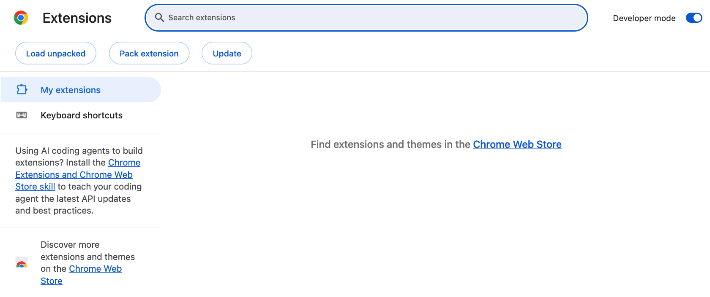
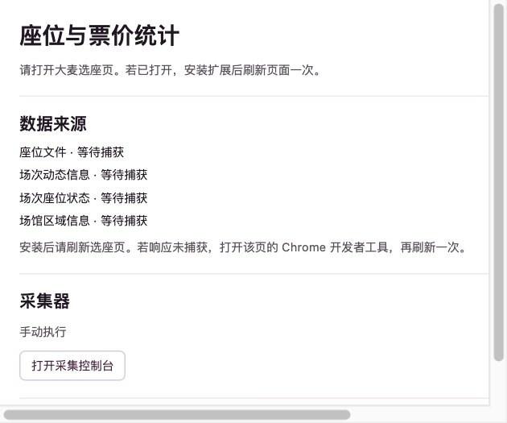
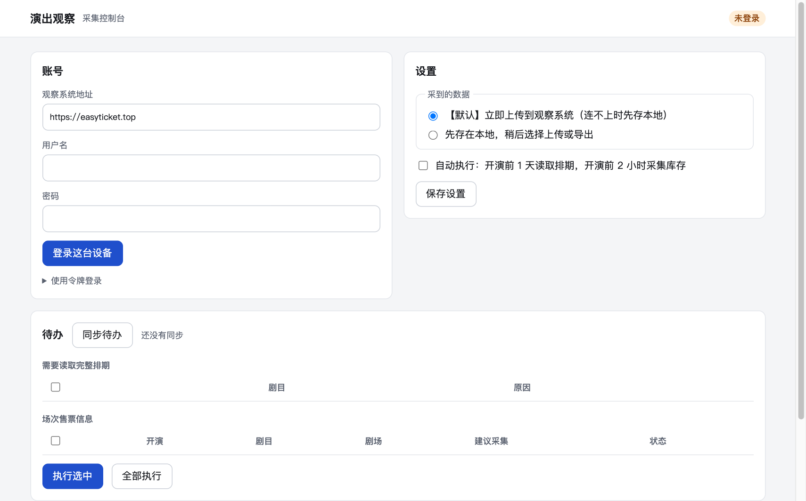

# 演出观察采集器

Chrome 扩展，**只需要装这一个**（它包含原来「大麦座位与票价统计」的全部手动功能，旧扩展请停用）。装在**已登录大麦**的 Chrome 里，按演出观察系统给出的待办去大麦取数据。

## 安装图解

1. 使用桌面版 Chrome 111 或更高版本。打开 [采集器下载页](https://github.com/woojooest/show-observer-collector/releases/latest)，下载 **show-observer-collector.zip**，解压并保留解压后的目录。如果安装过旧版「大麦座位与票价统计」，先在扩展程序页停用它。
2. 在 Chrome 地址栏输入 `chrome://extensions`，开启「开发者模式」（Developer mode），点击「加载已解压的扩展程序」（Load unpacked），选择解压后**直接包含 `manifest.json`** 的文件夹。看到「演出观察采集器」卡片即安装成功。

   

3. 打开浏览器工具栏的拼图菜单，点击「演出观察采集器」，再点「打开采集控制台」。也可以在扩展卡片的「详情」中找到「扩展程序选项」。

   

4. 服务器地址默认是 **`https://easyticket.top`**。使用演出观察网站的账号和密码登录，首次连接时同意 Chrome 对该站点的访问授权。账号开启了二次验证时，再输入验证器上显示的 6 位数字。自托管用户可以填写自己的 HTTPS 站点地址。

   

5. 登录后点击「同步待办」。回到 [演出观察账号页](https://easyticket.top/#/me) 并刷新，应该能在「扩展设备」看到当前设备。首次使用时，先在同一个 Chrome 配置中登录大麦，再选择待办执行。

### 更新与排查

- 更新时关闭采集控制台，把新版本文件解压到原扩展目录，再到 `chrome://extensions` 点扩展卡片上的重新加载按钮。保持原目录可保留登录状态和待上传记录。
- Chrome 找不到清单时，确认选择的目录直接包含 `manifest.json`。出现联网错误时，先在 Chrome 里打开演出观察网站，确认 HTTPS 能访问，再检查扩展的站点访问权限。
- 能登录但没有任务时，在网站关注一部剧目，或从剧目详情发起采集请求，然后再次同步。登录大麦后仍遇到验证页，先在大麦完成验证，再回控制台恢复采集。

安装流程可参考 [Chrome 官方文档](https://developer.chrome.com/docs/extensions/get-started/tutorial/hello-world#load-unpacked)。

## 采集控制台

点扩展图标 →「打开采集控制台」（也是扩展的「选项」页）。

- **账号**：填观察系统地址（本机或服务器），用观察系统的账号登录这台设备。只有一个登录框，服务器按账号判断是管理员还是用户；账号开了二次验证（管理员总是开着）时，输完密码会再要验证码。用户的登录 90 天后到期，管理员 30 天。登录后显示账号、角色、到期日和任务来源，可以「退出这台设备」。到期前 3 天控制台会提示。手动生成的令牌和旧的 `OBSERVER_TOKEN` 可以在「使用令牌登录」里填。登录时 Chrome 会请求访问该地址的权限。
- **登录失效**（到期、被退出或被停用）：自动执行暂停，控制台顶部提示重新登录。已经采到的库存存进本地，重新登录后在控制台上传；排期不存，之后会重新读取。
- **设置**：数据去向、自动执行开关。
- 用户的采集器只领到自己关注剧目的自动任务和自己在网页上发出的请求；管理员的采集器领到管理员关注的剧目和所有管理员的请求。
- **同步待办**：从观察系统拉取两类待办，存在本地，服务器之后连不上也能看：
  - **需要读取完整排期的剧目**：开演前 1 天首次读取、结束日期变动、或在剧目详情页点了「重新收集排期」。读取方式与「选座购票」弹层相同（`mtop.alibaba.detail.subpage.getdetail`，`dataType: 4`），先取日期列表再逐日取场次。
  - **场次**：今天的场次，加上在观察系统剧目详情页点了「采集这一场 / 重新采集这一场」的任意场次。每场显示开演时间、建议采集时间（开演前 2 小时）和状态。未开演、有选座页地址的场次都可以勾选；已采集的再采一次，新结果替换旧的。「全部执行」和全选只取还没采集或网页请求过的场次。
- **执行选中 / 全部执行**：采集今天的某一场前，先复核该剧目当天的场次（每个剧目每天一次），再打开选座页读取库存；提前请求的其他日期场次直接采集。采集时间由你决定，只要在开演之前。
- **数据去向**：
  - **立即上传**：结果直接写入观察系统；连不上服务器时自动先存本地。
  - **先存本地**：结果都存在扩展里，在「本地数据」里选择「全部上传」或「导出 JSON」。
- **自动执行**（默认关闭）：打开后每分钟向观察系统确认一次待办，到点自动读取排期、在开演前 2 小时采集库存，并执行网页上的采集请求（每个请求一次）。关闭时扩展不会主动访问大麦。

采集失败不写入任何结果：这一场仍可再试；开演时还没有快照，观察系统会自动记为缺失。

## 对大麦的访问节奏

- 一次只开一个后台标签页，用完即关。
- 每次打开页面后、每次接口调用前、两个页面之间，都随机等待 2–4 秒。
- 任何一次失败**最多重试一次**，再失败就停下并记在日志里。自动执行时，同一个任务当天不再自动尝试。
- 遇到登录页或验证页，**整个采集器暂停**，不再访问大麦。重新登录后，在控制台点「已重新登录，恢复采集」。

## 票档口径

- 每个票面价是一档：总量 = 该价格的座位数，余量 = 可选座位数。
- 该档里有状态未知的座位时，余量记为不可辨认（`null`），不计入占用率。
- 同时上传逐座的位置、票价和可选状态（座位图），观察系统的剧目详情页据此还原选座图。一场约 2,000 座，几十 KB。
- 票价未知的座位单独成一档「未知票价」，面价记为 `null`，总量和余量照实记录（计入占用率和售罄，不计入面价）。

## 出问题时

扩展图标上显示橙色「!」，最近的事件（包括原始错误）列在弹窗里。

## 手动统计

原来的手动面板保留不变：在选座页点扩展图标，可以查看按票面价的统计、导出逐座 CSV 和原始响应。以下为原说明。

解压后打开 Chrome 的扩展程序页 `chrome://extensions`。打开开发者模式，选择「加载已解压的扩展程序」，选中本文件所在的目录。刷新大麦选座页面，再打开扩展面板。缺少响应时，可打开该页面的开发者工具并刷新，然后再打开面板。

面板可以导出已捕获的座位文件、动态信息、座位状态和区域信息。支持的 JSON 格式可按座位 ID 关联库存，并用逐座票面价或票档表统计。逐座 CSV 包含已识别的区域、排、座号、票档、价格和状态。设置示例见面板的「字段映射」或 `help.html`。

全场均价是逐座票面价之和除以全场座位数。价格或覆盖范围无法确认时，面板只显示已知票价座位样本的均价。可选座位另算均价。面板与 CSV 按用户指定口径，将页面灰色座位计入已售。

已在大麦 2026-12-18 20:00 场次验证自动捕获、gzip/Protobuf 布局、按分区和逐座索引的库存解码、普通票面价格关联。库存码 2 对应彩色可选座位，库存码 8 对应灰色不可选座位。面板将灰色座位统一显示为已售。同一座位的促销票价不重复计入。其他格式若未能自动识别，可从面板下载原文核对。

在可校准的网格座位图或场馆底图上，面板提供「圈出未知票价区域」。半透明色带按排标出连续的未知票价座位，重新打开面板即可清除。

## 许可证

采集器及其安装文档采用 [MIT 许可证](LICENSE)。
